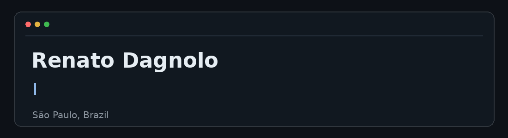

  

### About Me

- Focused on **Full Stack Development** and Software Engineering
- Exploring **React, Next.js, TypeScript & PostgreSQL**
- Interested in **Object-Oriented Programming, System Design & Database Architecture**

### Tech Stack

**Languages**

**Frameworks & Databases**

**Tools & IDEs**

### GitHub Activity

### Connect With Me

  &nbsp;
  &nbsp;
  

---

**Thanks for visiting my profile!**

Always learning, always building.

